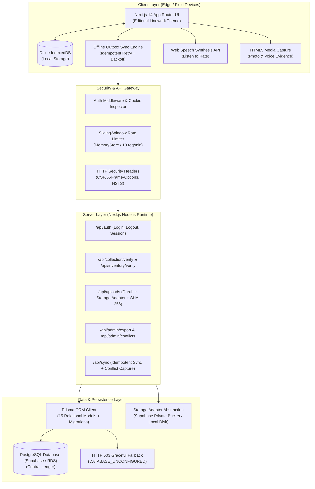

# ARCHITECTURE.md — BanaSetu System Architecture & Technical Specifications

> **System:** BanaSetu Minor Forest Produce (MFP) Ledger & Traceability Engine  
> **Jurisdiction:** Mayurbhanj District, Government of Odisha (TDCCOL / LABHA Scheme)  
> **Architecture Pattern:** Dual-Database Local-First Architecture with Cryptographic Verification

---

## 1. High-Level Architecture Diagram



---

## 2. Key Architectural Decisions & Subsystems

### 2.1 Dual-Database Resilience Architecture
- **Problem:** Remote tribal hamlets across the Similipal biosphere reserve lack continuous cellular signals. Operations must never stall due to offline conditions.
- **Solution:** 
  - **Client-Side:** IndexedDB managed through Dexie v4 stores all master tables (`weighmentRecords`, `syncQueue`, `products`, `discrepancies`). Submissions generate client ULIDs and write immediately to IndexedDB.
  - **Server-Side:** PostgreSQL schema managed via Prisma handles central synchronization, relational integrity, foreign key enforcement, and immutable audit logs.
  - **Unconfigured DB Resilience:** When `DATABASE_URL` is unconfigured, server endpoints return `HTTP 503 DATABASE_UNCONFIGURED`. Client engines detect this, retain records in the local outbox, and update status badges to `◆ PENDING_SYNC`.

### 2.2 Security & Session Management
- **Token Format:** JSON Web Tokens (JWT) signed via HMAC-SHA256 (`jose` library) using `AUTH_SECRET`.
- **Storage:** Stored in `HttpOnly`, `SameSite=Lax`, `Secure` (in production) cookies under `banasetu_token`.
- **Role-Based Access Control (RBAC):** Five distinct operational tiers:
  1. `COLLECTOR`: Low-literacy collection requests, rate inspection, offline draft recovery.
  2. `SHG_FACILITATOR`: SHG aggregation, assistance, and weighment witness.
  3. `COLLECTION_MANAGER`: Physical scale weighment verification, sack tare deduction, receipt tag generation.
  4. `WAREHOUSE_MANAGER`: Depot arrival reweighing, transit shrinkage calculation, stock allocation.
  5. `SUPERVISOR_ADMIN`: Rate card configuration, user provisioning, discrepancy resolution, audit export.

### 2.3 Idempotency & Conflict Resolution
- Every mutation payload requires a unique `idempotencyKey` (UUIDv4 or ULID).
- In-flight retries are deduplicated at both the database level (unique constraint on `idempotencyKey`) and in the server memory store.
- If a duplicate request arrives, the server immediately returns the previously committed record with an `X-Idempotent-Replay: true` header without creating a duplicate weighment or double payment record.

### 2.4 Transit Shrinkage Engine & Quarantine Segregation
- **Physical Reality:** Fresh forest produce loses weight during transit between collection centers (e.g. Karanjia) and central depots (e.g. Baripada) due to natural moisture evaporation.
- **Mathematical Invariant:**
  $$\text{Loss} = W_{\text{dispatched}} - W_{\text{received}}$$
  $$\text{Shrinkage \%} = \frac{\text{Loss}}{W_{\text{dispatched}}} \times 100$$
- **Rule:** If $\text{Shrinkage \%} \le \text{Tolerance}$ (default 1.5%), the loss is logged as natural evaporation and inward status is `VERIFIED`.
- If $\text{Shrinkage \%} > \text{Tolerance}$, the batch is automatically segregated to `QUARANTINED_DISCREPANCY` and routed to the supervisor discrepancy review queue.
- **Fair-Trade Guardrail:** Inward warehouse discrepancies *never* alter or reduce the original tribal gatherer's accepted field weight or payment reference.

---

## 3. Directory Structure

```
c:/Users/princ/Documents/bana-setu-main/
├── .github/workflows/ci.yml       # GitHub Actions CI matrix
├── prisma/
│   ├── migrations/0_init/        # Baseline PostgreSQL migration (DDL)
│   ├── schema.prisma             # 15 PostgreSQL relational models
│   └── seed.ts                   # Non-destructive, idempotent pilot seed
├── public/
│   └── uploads/                  # Uploaded photo evidence (local fallback)
├── scripts/
│   ├── check-a11y.ts             # WCAG 2.1 AA automated audit
│   ├── check-i18n.js             # Bilingual key parity validator
│   ├── test-admin-f11.ts         # Admin & export test suite
│   ├── test-auth-rbac.ts         # JWT & role permission suite
│   ├── test-backend-f4-f15.ts    # Rate limiting & security suite
│   ├── test-catalogue-g1.ts      # 17 MFP catalogue & geo suite
│   ├── test-collection-f4.ts     # Intake weighment & tare suite
│   ├── test-collector-f3.ts      # Tribal collector UX suite
│   ├── test-database-pilot.ts    # Database persistence & safety test suite
│   ├── test-flows-g4.ts          # Dead-button & route integrity suite
│   ├── test-inventory-f5.ts      # Transit shrinkage & stock suite
│   └── test-uploads-f5.ts        # Multipart upload & SHA-256 suite
├── src/
│   ├── app/
│   │   ├── admin/page.tsx        # Super-admin console (6 tabs)
│   │   ├── api/                  # 12 Next.js Route Handlers
│   │   ├── collection/page.tsx   # Collection center intake
│   │   ├── collector/page.tsx    # Low-literacy tribal collector PWA
│   │   ├── inventory/page.tsx    # Central warehouse & stock ledger
│   │   ├── login/page.tsx        # Auth login with persona switcher
│   │   ├── unauthorized/page.tsx # 403 access forbidden guidance
│   │   └── verify/page.tsx       # Public trust verification portal
│   ├── components/
│   │   ├── map/                  # TransitRouteMap (pure SVG)
│   │   ├── ui/                   # ProductIcons (17 linework SVGs)
│   │   └── weather/              # WeatherAdvisoryCard
│   └── lib/
│       ├── db.ts                 # Dexie IndexedDB client
│       ├── products.ts           # 17 MFP botanical catalogue
│       ├── speech.ts             # Web Speech synthesis helper
│       └── server/               # auth.ts, rateLimit.ts, response.ts
└── tailwind.config.ts            # Editorial design tokens
```
