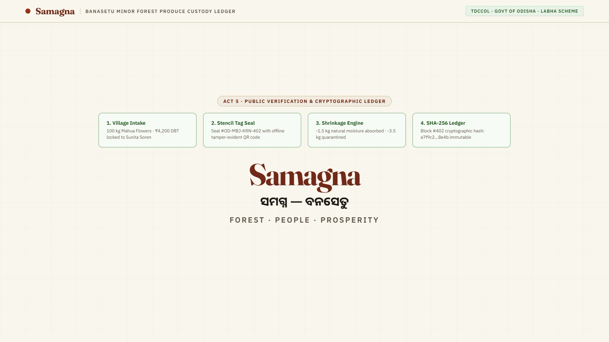

# Samagna · BanaSetu (ସମଗ୍ନ)

> **Minor Forest Produce (MFP) Procurement & Traceability Custody Ledger**<br />
> **Jurisdiction:** Mayurbhanj District, Government of Odisha<br />
> **Scheme Alignment:** Tribal Development Cooperative Corporation of Odisha Ltd. (TDCCOL) & 100% State-Funded LABHA Scheme (*Laghu Bana Jatiya Dradya Kraya*)<br />
> **Target Demographic:** 1.4 Million Tribal Primary Gatherers across Mayurbhanj & Similipal Biosphere Reserve<br />
> **Design Identity:** Warm Editorial Field Ledger (`#E86033` Terracotta, `#243828` Deep Forest Green, `#FAF6F0` Warm Parchment, `#FFFFFF` Ledger White)

---

## 1. Project Overview

**Samagna** (*BanaSetu*) is a digital procurement and custody traceability ledger designed for tribal Minor Forest Produce (MFP) collectors in Odisha.

Historically, primary tribal gatherers suffered from delayed cash settlements, arbitrary quality downgrades, and punitive weight deductions disguised as "transit shrinkage."

Samagna addresses these structural challenges through:
1. **Low-Literacy First Interface:** Zero-typing workflows, native Odia typography (Noto Sans Oriya), authentic botanical photography, and Web Speech synthesis ("Listen to Rate") for non-literate forest dwellers.
2. **Dual-Database Offline Resilience:** Operates 100% offline in deep forest terrain using client-side IndexedDB (Dexie). Syncs idempotently to central PostgreSQL when connectivity resumes.
3. **Non-Accusatory Shrinkage Segregation:** Natural moisture loss in transit is mathematically verified against botanical thresholds. Quarantined batches are isolated for administrative review without retroactively altering or deducting the gatherer's certified field payment.
4. **Verifiable Custody & Public Traceability:** Digital scale math (gross - tare = net), QR-code bag tags, and public ledger verification (`/verify/[code]`) with automated PII masking.

---

## 2. Product Walkthrough & Demo

[](public/demo/banasetu-demo.mp4)

> 🎥 **[Watch the full high-resolution MP4 demo video](public/demo/banasetu-demo.mp4)** showcasing the complete end-to-end custody flow from tribal gatherer intake in Similipal to warehouse arrival and public QR verification.

<video src="public/demo/banasetu-demo.mp4" controls="controls" poster="public/demo/banasetu-demo-poster.jpg" width="100%">
  Your browser does not support the video tag. <a href="public/demo/banasetu-demo.mp4">Download or view the demo video directly</a>.
</video>

---

## 3. Quickstart & Local Execution

### Prerequisites
- Node.js 20.x or higher
- npm 10.x or higher

```bash
# 1. Install dependencies cleanly
npm ci

# 2. Configure environment variables (copy template)
cp .env.example .env.local

# 3. Generate Prisma database client
npx prisma generate

# 4. Run automated test suites
npm run test:all

# 5. Start local development server
npm run dev
```

Open [http://localhost:3000](http://localhost:3000) in your web browser.

---

## 3. Role Personas for Sandbox Evaluation

For evaluation and demonstration, navigate to [`/login`](http://localhost:3000/login) to use the 1-Click Persona Quick-Switcher:

| Persona Name | Role | Primary Interface | Sandbox Responsibilities |
|:---|:---|:---|:---|
| **Rami Majhi** | `COLLECTOR` | `/collector` | Primary Santhal tribal gatherer. Requests pickup, checks MSP rates, listens to audio rate cards, views receipts. |
| **Sumitra Soren** | `SHG_FACILITATOR` | `/facilitator` | Local SHG leader. Aggregates collection requests from forest hamlets and assists elders. |
| **Bikram Marndi** | `COLLECTION_MANAGER` | `/collection` | Operates village aggregation center scale. Performs physical weighments, deducts sack tare, issues bag tags. |
| **Debasis Das** | `WAREHOUSE_MANAGER` | `/inventory` | Central depot manager at Baripada. Reweighs arrival trucks, tracks transit shrinkage, allocates outward sales. |
| **District Collector** | `SUPERVISOR_ADMIN` | `/admin` | Mayurbhanj District Administration. Configures rate cards, reviews quarantined batches, exports audit logs. |

---

## 4. Verification Test Suites Matrix

Run individual test suites or the entire automated suite via `npm run test:all`:

| Test Command | Scope & Verified Logic |
|:---|:---|
| `npm run test:i18n` | Bilingual English/Odia translation key parity (189 keys, 100% parity) |
| `npm run test:a11y` | WCAG 2.1 AA token contrast ratios, keyboard accessibility, ARIA |
| `npm run test:auth` | Fail-secure production auth secrets, JWT session cookies, RBAC permissions |
| `npm run test:collector` | Collector pickup flow, offline drafts, audio speech fallback |
| `npm run test:collection` | Scale math (gross - tare = net), receipt generation, idempotency |
| `npm run test:inventory` | Transit shrinkage math, botanical tolerance, quarantine bay, stock |
| `npm run test:backend` | Sliding-window rate limiting, HTTP error schemas, security headers |
| `npm run test:uploads` | Multipart parser, MIME whitelist, magic bytes validation, SHA-256 |
| `npm run test:catalogue` | 17 verified MFP species, Mayurbhanj geography, botanical rates |
| `npm run test:admin` | Admin clearance, rate card adjustments, immutable CSV export |
| `npm run test:flows` | Route integrity, interactive element audit, zero dead links |
| `npm run test:release-qa` | Comprehensive cross-role QA audit across all routes, buttons, and endpoints |
| **`npm run test:all`** | **Full System Pipeline (All 24 automated test suites)** |

---

## 6. Architecture & Documentation

In-depth technical specifications are available in the [`docs/`](./docs/) directory:

- **[`docs/architecture.md`](./docs/architecture.md):** Technical deep-dive into dual-engine architecture, IndexedDB outbox, and JWT sessions.
- **[`docs/security.md`](./docs/security.md):** Security posture, RBAC boundary enforcement, rate limiting, and audit logs.
- **[`docs/deployment.md`](./docs/deployment.md):** Clean-clone setup, PostgreSQL migration commands, and containerization.
- **[`docs/DATABASE_SETUP.md`](./docs/DATABASE_SETUP.md):** Local and hosted PostgreSQL configuration guide.
- **[`docs/presentations/`](./docs/presentations/):** Project slide decks and executive presentation materials.

---

## 7. Technical Reality & Disclaimers

1. **Non-Banking Sandbox:** Payout reference numbers (e.g. `PAY-MAYURBHANJ-xxx`) are simulated for demonstration. Live DBT integration requires formal banking clearance from the Reserve Bank of India and state treasury.
2. **Provisional Rates:** Procurement rates (e.g. Mahua at ₹42/kg) and shrinkage allowances (1.5%) are sourced from baseline guidelines and are clearly labelled illustrative in the UI.
3. **No Biometric Fingerprint Capture:** In strict compliance with Indian data privacy regulations, no biometric fingerprint templates are captured or stored.
