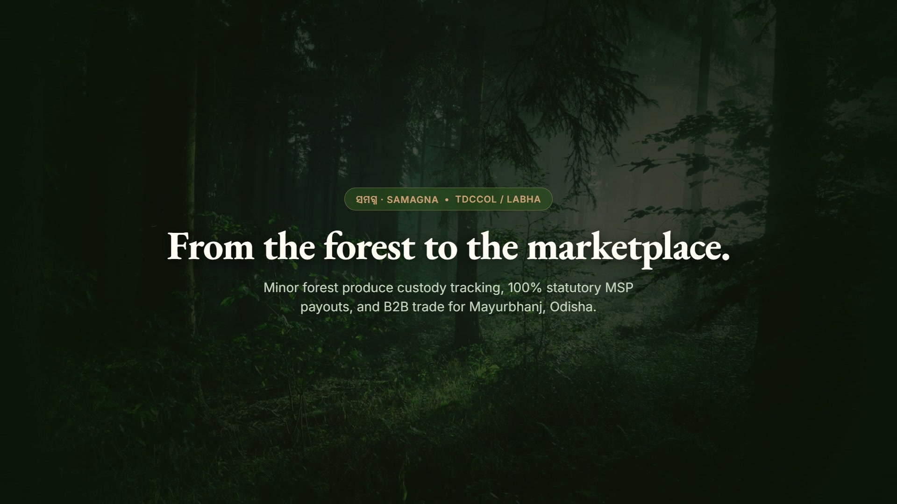

# Samagna · ସମଗ୍ନ — From the Forest to the Marketplace

> **Institutional Digital Public Infrastructure for Minor Forest Produce (MFP) Procurement, Custody Traceability & B2B Trade**  
> **Jurisdiction:** Mayurbhanj District & Similipal Biosphere Reserve, Government of Odisha  
> **Statutory Mandate:** Tribal Development Cooperative Corporation of Odisha Ltd. (TDCCOL) & 100% State-Funded LABHA Scheme (*Laghu Bana Jatiya Dradya Kraya*)  
> **Target Demographic:** 1.4 Million Tribal Primary Gatherers across 26 Blocks of Mayurbhanj  

---

## 1. Problem & Context

Historically, tribal primary gatherers collecting Minor Forest Produce (MFP)—such as Sal seeds, wild Mahua flowers, Chironji, Harida, and wild forest honey in the Similipal Biosphere Reserve—faced entrenched systemic barriers:
- **Arbitrary Weighment Deductions:** Uncalibrated analog spring scales and arbitrary tare deductions deprived forest dwellers of fair earnings.
- **Punitive "Transit Shrinkage" Deductions:** Natural botanical moisture loss occurring during transport from village centers to district warehouses was routinely docked from gatherer payouts.
- **Delayed Cash Settlements:** Primary gatherers waited weeks or months for manual paper vouchers to clear government treasury audits.
- **Informal Middleman Monopolies:** Commercial Ayurvedic, pharmaceutical, and FMCG buyers had zero verified provenance, forcing them through opaque brokers who took up to 60% of product margins.

---

## 2. The Samagna Solution

**Samagna · ସମଗ୍ନ** bridges forest hamlets directly to institutional procurement and enterprise wholesale markets through an integrated, resilient platform:

1. **Statutory 100% Minimum Support Price (MSP) Direct Benefit Transfer (DBT):** Gatherers receive immediate, un-discounted payments directly into their bank accounts under the Odisha LABHA Scheme with ₹0 intermediary cuts.
2. **Dual-Database Offline Resilience:** Field personnel operate in zero-connectivity jungle tracts using client-side IndexedDB (Dexie.js), automatically synchronizing with central PostgreSQL when network pings succeed.
3. **Low-Literacy First Interface:** Zero-typing workflows, bilingual Odia typography, authentic botanical photography, and Web Speech synthesis ("Listen to Rate") for non-literate forest dwellers.
4. **Non-Accusatory Shrinkage Isolation:** Botanical moisture loss is mathematically calculated against validated scientific evaporation curves. Suspect batches are quarantined for administrative review without retroactively altering or deducting the gatherer's certified field payment.
5. **Tamper-Evident Bag Tagging & Public Traceability:** Every jute sack receives a unique cryptographic QR tag tracking batch custody from harvest trees through village procurement centers (VPCs) and central depots to commercial buyers via `/verify/[code]`.
6. **Commercial B2B Marketplace & RFQ Bidding:** Enterprise buyers (e.g. Dabur, Patanjali, certified organic processors) bid on verified bulk lots with laboratory quality dossiers, digital contracts, and automated escrow.

---

## 3. Product Walkthrough & Demo

[](public/demo/banasetu-demo.mp4)

> 🎥 **[Watch the full high-resolution MP4 demo video](public/demo/banasetu-demo.mp4)** showcasing the complete custody lifecycle from forest collection in Similipal to warehouse arrival and public QR verification.

---

## 4. Visual Interface Preview

| Field Operations (B2G) | Enterprise Wholesale (B2B) |
|:---:|:---:|
|  |  |
| *Offline Digital Scale Weighment & Instant DBT* | *Bulk Lot Bidding, Traceability & Purchase Orders* |

| Bag Tag QR Dossier | Central Depot Moisture Reweigh |
|:---:|:---:|
|  |  |
| *Tamper-Evident Physical Bag Tag with GPS* | *Automated Transit Shrinkage Calculation & Triage* |

---

## 5. Technology Stack

- **Framework:** Next.js 14 (App Router, Server Components, Streaming SSR)
- **Styling & Design System:** Tailwind CSS, CSS Custom Properties, Fluid `clamp()` Typography
- **Typography:** Fraunces (Variable Display Serif), Manrope (Humanist Sans), IBM Plex Mono, Noto Sans Oriya
- **State & Client DB:** Dexie.js (IndexedDB Offline Engine), Zustand (State Stores)
- **Server Database & ORM:** PostgreSQL 15+, Prisma ORM, Serverless Connection Pooling
- **Authentication & Security:** Jose (HMAC-SHA256 JWT sessions), BcryptJS, Strict Content Security Policy (CSP)
- **PDF & Barcode Generation:** PDFKit (Server-signed receipts & audit dossiers), QRCode
- **Icons & Visuals:** Lucide React, Custom Topographic Vectors, Authentic Botanical Photography

---

## 6. Architecture & Folder Overview

```
c:\Users\rudra\Bana Setu\
├── docs/                          # Architecture, threat model, testing & redesign blueprints
├── prisma/                        # Database schema, migrations, and PostgreSQL seed scripts
├── public/
│   ├── demo/                      # Demonstration video and fallback slide assets
│   ├── icon.svg                   # Vector favicon & application mark
│   └── products/                  # 17 authentic botanical produce photographs
├── scripts/                       # 39 specialized verification & QA test harnesses
├── src/
│   ├── app/                       # Next.js App Router (Public, Ops, Trade, Store, APIs)
│   │   ├── api/                   # REST endpoints (auth, batches, sync, pdf, assistant)
│   │   ├── collection/            # Village Procurement Center (VPC) Scale Desk
│   │   ├── collector/             # Low-literacy tribal gatherer offline interface
│   │   ├── demo/                  # Evaluator stage demo orchestrator & state manager
│   │   ├── institutional/         # District & State supervisory dashboards
│   │   ├── inventory/             # Baripada Central Depot reweigh & moisture triage
│   │   ├── login/                 # 12-Role Sandbox Persona Quick-Switcher
│   │   ├── store/                 # Consumer e-commerce showcase & order portal
│   │   ├── trade/                 # Enterprise B2B wholesale marketplace & RFQ
│   │   └── verify/                # Public batch dossier inspection engine
│   ├── components/                # Modular UI atoms, shells, artifacts, and landing sections
│   ├── context/                   # Global application state & offline sync context
│   ├── demo/                      # Demo seed fixtures & pristine reset states
│   ├── i18n/                      # Bilingual English & Odia localization
│   ├── lib/                       # Shrinkage math, DB client, server utilities, security
│   └── store/                     # Zustand stores for cart and application state
├── .editorconfig
├── .eslintrc.json
├── .gitignore
├── CONTRIBUTING.md
├── LICENSE
├── netlify.toml
├── next.config.js
├── package.json
├── render.yaml
└── tailwind.config.ts
```

---

## 7. Quickstart & Local Setup

### Prerequisites
- **Node.js:** 20.x or higher
- **npm:** 10.x or higher

### Installation
```bash
# 1. Clone repository
git clone https://github.com/Rudra4451/Samagna.git
cd Samagna

# 2. Install dependencies
npm ci

# 3. Configure environment variables
cp .env.example .env.local

# 4. Generate Prisma database client
npx prisma generate

# 5. Run test suites
npm run test:all

# 6. Start development server
npm run dev
```

Open [http://localhost:3000](http://localhost:3000) in your web browser.

---

## 8. Role Personas for Sandbox Evaluation

Navigate to [`/login`](http://localhost:3000/login) to access the **1-Click Persona Evaluator Hub** featuring 12 pre-configured system roles:

| Category | Persona Name | Role Code | Destination | Sandbox Responsibilities |
|:---|:---|:---|:---|:---|
| **B2G Operations** | **Sunita Soren** | `COLLECTOR` | `/collector` | Primary gatherer. Audio rate lookup, offline pickup requests, receipt inspection. |
| **B2G Operations** | **Sumitra Marndi** | `SHG_FACILITATOR` | `/facilitator` | Women SHG lead. Village-level produce aggregation and member payment ledger. |
| **B2G Operations** | **R. K. Mohanty** | `COLLECTION_MANAGER` | `/collection` | Karanjia VPC manager. Electronic scale weighment, sack tare deduction, QR tagging. |
| **B2G Operations** | **S. Das** | `WAREHOUSE_MANAGER` | `/inventory` | Baripada Central Depot custodian. Reweighing, transit moisture triage, stock dispatch. |
| **B2G Operations** | **A. Patnaik (DPO)** | `SUPERVISOR_ADMIN` | `/institutional` | Mayurbhanj District Admin. LABHA scheme oversight, rate card controls, audit logs. |
| **B2G Operations** | **Comptroller** | `SUPERVISOR_ADMIN` | `/revenue` | State Treasury Comptroller. DBT settlement reconciliation and financial audit. |
| **B2B Commercial** | **Dabur Sourcing** | `SUPERVISOR_ADMIN` | `/trade` | Commercial enterprise buyer. Bulk lot bidding, RFQ quotes, wholesale contracts. |
| **B2B Commercial** | **Koraput Agro** | `SUPERVISOR_ADMIN` | `/processing` | Value-add processing facility. Milling, grading, oil extraction, batch intake. |
| **B2B Commercial** | **Mayurbhanj Express** | `SUPERVISOR_ADMIN` | `/logistics` | State logistics carrier. GPS vehicle tracking, waybill confirmation, custody handover. |
| **B2B Commercial** | **Tribal Retail Network** | `SUPERVISOR_ADMIN` | `/distribution` | B2B2C retail network. Channel partner quotas, store consignment, referral tracking. |
| **B2B Commercial** | **Similipal Bio-FPO** | `SUPERVISOR_ADMIN` | `/ecosystem` | Producer organisation director. SHG federation governance and member compliance. |
| **Public Portal** | **Verified Public** | `GUEST` | `/verify` | Public consumer/auditor. Transparent batch dossier verification via QR code. |

---

## 9. Verification & Quality Assurance Matrix

The repository contains 39 automated verification test suites spanning domain math, security, and accessibility:

```bash
# Run all test suites in sequence
npm run test:all
```

Key test suites:
- `npm run test:i18n`: Validates 100% key parity between English and Odia dictionaries.
- `npm run test:a11y`: Enforces WCAG 2.1 AA token contrast ratios and focus visibility.
- `npm run test:auth`: Validates RBAC route guards, JWT security, and fail-secure fallbacks.
- `npm run test:collection`: Verifies gross-minus-tare scale arithmetic and receipt generation.
- `npm run test:inventory`: Validates botanical shrinkage tolerance limits and quarantine logic.
- `npm run test:offline-photo`: Tests Dexie IndexedDB binary photo sync and replay prevention.
- `npm run test:pdf-download-share`: Validates PDF receipt generation, file headers, and sharing.
- `npm run test:release-qa`: Comprehensive 138-point release gate across all endpoints and routes.

---

## 10. Deployment

Samagna is optimized for zero-configuration deployment on modern cloud platforms:

- **Vercel / Netlify:** Configured with `netlify.toml` and Next.js App Router streaming runtime.
- **Docker / Self-Hosted:** Run `npm run build && npm run start` on any Node.js 20+ host.
- **Database:** Compatible with Supabase PostgreSQL, AWS RDS, Neon, or self-hosted PostgreSQL 15+.

---

## 11. Contributing & Governance

Contributions are governed by our [Contributing Guidelines](CONTRIBUTING.md). Please ensure all pull requests follow Conventional Commits and pass all 39 verification suites before submission.

---

## 12. License & Contact

- **License:** Licensed under the [MIT License](LICENSE).
- **Institutional Oversight:** Tribal Development Cooperative Corporation of Odisha Ltd. (TDCCOL), Government of Odisha.
- **Technical Inquiries:** Department of Scheduled Tribes & Scheduled Castes Development, Minor Forest Produce Directorate, Mayurbhanj, Odisha.
