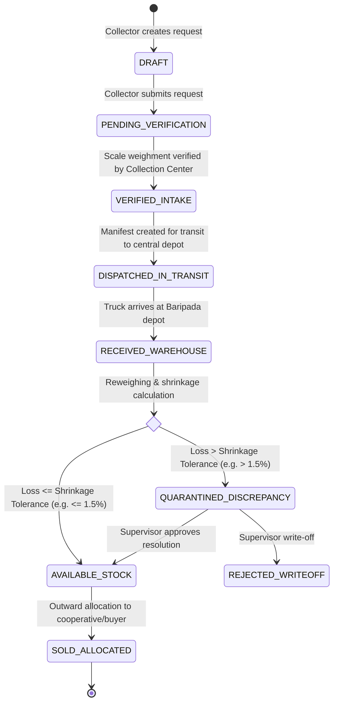
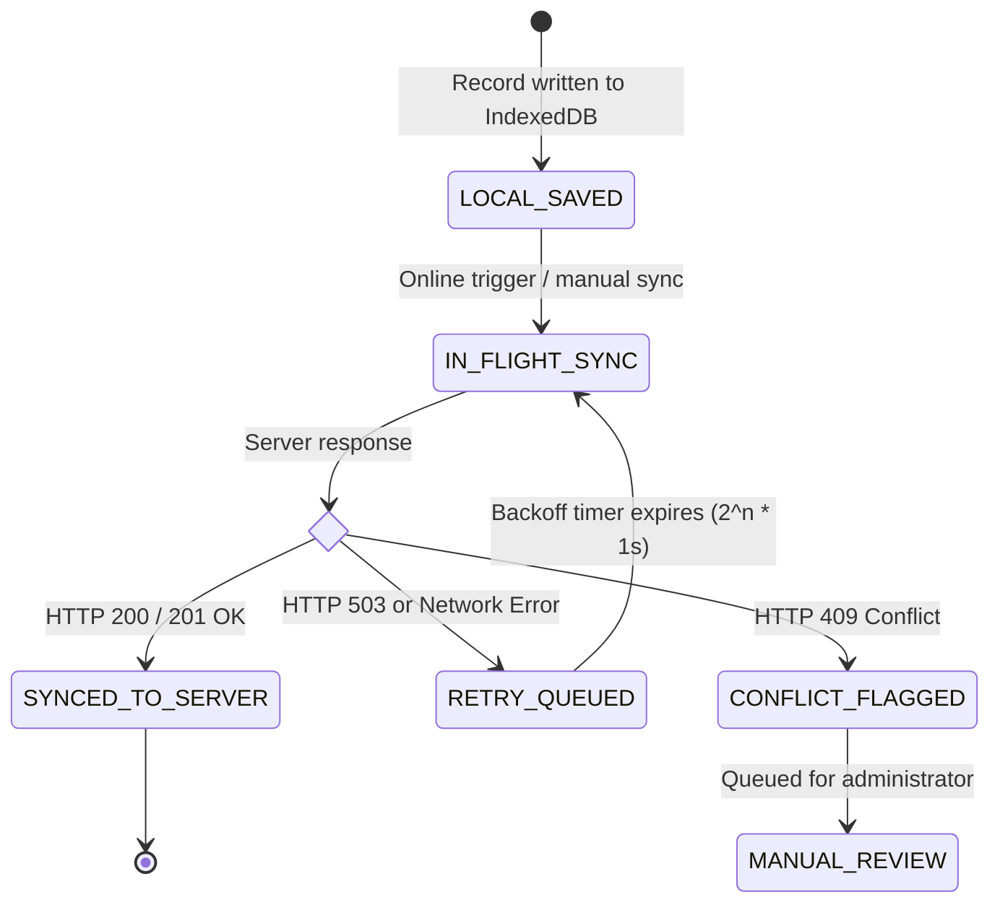

# STATES.md — BanaSetu Finite State Machines & Lifecycle Specifications

> **System:** BanaSetu Minor Forest Produce (MFP) Ledger  
> **Jurisdiction:** Mayurbhanj District, Government of Odisha (TDCCOL / LABHA Scheme)  
> **Type:** Normative Lifecycle & Invariant State Specifications

---

## 1. Batch & Physical Produce Lifecycle State Machine

### State Definitions & Permissions

| State | Responsible Actor | Permitted Transitions | Guardrails & Invariants |
|:---|:---|:---|:---|
| `DRAFT` | `COLLECTOR` | $\rightarrow$ `PENDING_VERIFICATION` | Local auto-save in IndexedDB. Editable until submission. |
| `PENDING_VERIFICATION` | `COLLECTOR` / `SHG_FACILITATOR` | $\rightarrow$ `VERIFIED_INTAKE`, $\rightarrow$ `CANCELLED` | Awaiting physical weighment at aggregation center. Can be cancelled within 6s undo window. |
| `VERIFIED_INTAKE` | `COLLECTION_MANAGER` | $\rightarrow$ `DISPATCHED_IN_TRANSIT` | Net weight certified on scale. Tare subtracted. Field payment reference generated. |
| `DISPATCHED_IN_TRANSIT` | `COLLECTION_MANAGER` | $\rightarrow$ `RECEIVED_WAREHOUSE` | In transit between forest center (e.g. Karanjia) and central depot (Baripada). |
| `RECEIVED_WAREHOUSE` | `WAREHOUSE_MANAGER` | $\rightarrow$ `AVAILABLE_STOCK`, $\rightarrow$ `QUARANTINED_DISCREPANCY` | Depot reweighed gross/tare. Natural shrinkage mathematically evaluated. |
| `QUARANTINED_DISCREPANCY` | `SUPERVISOR_ADMIN` | $\rightarrow$ `AVAILABLE_STOCK`, $\rightarrow$ `REJECTED_WRITEOFF` | Isolated from inventory. Original field gatherer payout reference is **unaltered**. |
| `AVAILABLE_STOCK` | `WAREHOUSE_MANAGER` | $\rightarrow$ `SOLD_ALLOCATED` | Available for outward sale. Stock cannot become negative. |
| `SOLD_ALLOCATED` | `WAREHOUSE_MANAGER` | Terminal state | Allocation quantity cannot exceed available stock. |

---

## 2. Offline Outbox Synchronization State Machine

### Sync State Invariants
1. **Never Discard Unsynced Work:** Under no condition does a network error, app crash, or HTTP 503 response delete a local Dexie record.
2. **Exponential Backoff:** Retries increment an attempt counter $n$. Retry delay is computed as:
   $$\text{Delay} = \min(2^n \times 1000\text{ms}, 30000\text{ms})$$
3. **Idempotency Guarantee:** Every synchronized payload includes an `idempotencyKey`. The server uses a unique database constraint to ensure identical submissions are committed exactly once.

---

## 3. Discrepancy & Shrinkage Segregation Logic

Given:
- $W_{\text{field}}$ = Certified field net weight recorded at forest collection center.
- $W_{\text{wh}}$ = Arrival net weight measured at central warehouse depot.
- $T_{\text{pct}}$ = Allowable natural shrinkage tolerance percentage (e.g. $1.5\%$).

The shrinkage percentage $S_{\text{pct}}$ is calculated:
$$S_{\text{pct}} = \max\left(0, \frac{W_{\text{field}} - W_{\text{wh}}}{W_{\text{field}}} \times 100\right)$$

### Branching Matrix:
1. **Case A ($S_{\text{pct}} \le T_{\text{pct}}$):**
   - Result: Transit loss is approved as natural botanical moisture loss.
   - Status $\rightarrow$ `AVAILABLE_STOCK`.
   - Verified Stock Weight $\leftarrow W_{\text{wh}}$.
2. **Case B ($S_{\text{pct}} > T_{\text{pct}}$):**
   - Result: Transit loss exceeds allowable tolerance.
   - Status $\rightarrow$ `QUARANTINED_DISCREPANCY`.
   - Supervisor case created with severity = `HIGH`.
   - Stock is quarantined and blocked from outward allocation.
   - **Protection Rule:** Gatherer's payable amount based on $W_{\text{field}}$ remains **100% intact**.
