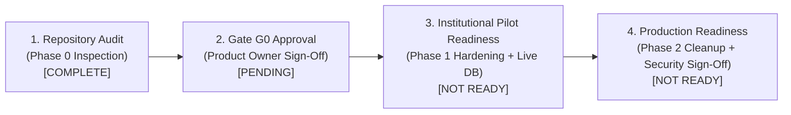

# SAMAGNA — PHASE 0 FINDINGS REGISTER

> **Document:** Phase 0 Read-Only Verification Findings Register (Post-Reconciliation Revision)  
> **System:** Samagna Minor Forest Produce (MFP) Custody & Traceability Ledger  
> **Jurisdiction:** Mayurbhanj District, Government of Odisha (TDCCOL / LABHA Scheme)  
> **Auditor Role:** Principal Software Engineer, Application Security Auditor, Database Auditor & QA Lead  
> **Authoritative Specification Baseline:** Samagna Product and Technical Specification v1.0  
> **Audit Execution Date:** 2026-11-07  
> **Repository Branch:** `master`  
> **Commit Hash:** `c71049bea79d981b2cd88842cfc6cbf9c42e1c30`  
> **Audit Environment:** Existing Local Working Directory (`c:\Users\rudra\Bana Setu`) — *Not a clean clone*  
> **Working-Tree Status at Start:** Clean (0 unstaged changes, 0 uncommitted files)  
> **Governance Status:** APPROVED BY PRODUCT OWNER (GATE G0 SIGNED OFF — REMEDIATION AUTHORIZED)  
> **Sign-Off Timestamp:** 2026-11-07T07:57:24+05:30  

---

## 1. Audit Scope & Absolute Restrictions Compliance

This verification pass was conducted under strict **READ-ONLY** restrictions. In accordance with the Phase 0 audit mandate:
- **No application code** was modified, refactored, or fixed.
- **No Prisma schemas or migration SQL** were altered or applied.
- **No dependencies** were installed, upgraded, or removed in `package.json` or `package-lock.json`.
- **No configuration files** (`next.config.js`, `tsconfig.json`, `.env`, etc.) were edited.
- **No live database mutations, migrations, or destructive commands** were executed.
- **No commits, pushes, deployments, or public artifacts** were generated.
- **No Git tags were created** (Decision O4 will be executed during the designated phase).
- Deliverables generated strictly comprise `docs/findings-register.md` and `docs/spec-change-log.md`.

---

## 2. V1–V10 Verification Summary Matrix (Reconciled)

| Verification ID | Focus Area | Status | Severity | Primary Finding |
|:---|:---|:---:|:---:|:---|
| **V1** | Database Schema & PII Inventory | **PARTIAL** | **HIGH** | 16 Prisma models exist. Weight, rate, and payout fields use IEEE-754 `Float` (`DOUBLE PRECISION`), creating precision truncation risks. PII stored across multiple models. |
| **V2** | Next.js Version & Security Status | **PARTIAL** | **HIGH** | Declared `14.2.15`, locked `14.2.15` (pinning verified). Upstream status carries multiple unpatched CVEs (GHSA-p293-qw3h-jr36, GHSA-2xp9-vwfh-vxw4, GHSA-2464-fhr4-w9xw, GHSA-7m27-7ghc-44w9). Requires managed upgrade. |
| **V3** | Server-Side Auth & Authorisation Across Protected API Routes | **PASS** | **LOW** | All 16 protected API routes independently enforce server-side authentication (`requireServerRole` or `getSession`). Intentionally public endpoints (4) and public QR lookups (1) correctly separated. |
| **V4** | Persona Login Guard | **FAIL** | **HIGH** | Evaluator personas and test credentials (`Test@Pass123`) are hardcoded in the client bundle and rendered without production guards. Environment variable `ALLOW_DEMO_ACCOUNTS=true` allows test persona login. |
| **V5** | Evidence Storage Security | **PASS** | **LOW** | Managed Supabase Storage with strict fail-closed local behavior. Signed URLs expire in 3600s. Magic bytes validation, 5MB limit, and SHA-256 integrity hashing enforced. |
| **V6** | Marketplace & Browser-Held Inventory | **FAIL** | **HIGH** | Outward stock sales flow stores commercial transactions in Dexie (`inventorySales`). Extensive commercial marketplace subsystem (9 routes, cart, B2B/B2C) exists beyond core Spec v1.0. Locked owner decisions O4/O11 apply. |
| **V7** | Verification-Code Security | **PARTIAL** | **HIGH** | Public verification route (`/api/batches/[id]`) cleanly masks PII and enforces rate limits, but sequential short batch codes (`BS-XXX`) allow trivial enumeration. |
| **V8** | AuditLog Database Permissions | **FAIL** | **CRITICAL** | `AuditEvent` table has no PostgreSQL triggers, rules, or REVOKE permissions preventing `UPDATE` or `DELETE`. Single database role used for both DDL and runtime DML. |
| **V9** | Client/Server Parity (Weighment & Shrinkage) | **PARTIAL** | **MEDIUM** | Formula sign conventions and tolerance thresholds differ between client (`unexplainedVariance < 0`) and server (`unexplainedVarianceKg > 0.05 kg`). |
| **V10** | Clean-Clone Test Baseline | **PARTIAL** | **MEDIUM** | Environment is an existing working directory, not a clean clone. On commit `c71049b`, only `test:commercial` was directly executed and evidenced (36/36 passed). Composite `test:all` was not re-executed on `c71049b`. |

- **Reconciled Totals:** **3 PASS**, **4 PARTIAL**, **3 FAIL**, **0 NOT VERIFIED**.

---

## 3. Detailed Technical Findings

### V1 — Database Schema & PII Inventory

- **Status:** PARTIAL
- **Severity:** HIGH
- **Files Inspected:**
  - `prisma/schema.prisma` (lines 1–424)
  - `prisma/migrations/0_init/migration.sql` (lines 1–417)
  - `prisma/seed.ts` (lines 1–294)

#### What the Implementation Actually Does:
1. **Total Prisma Model Count:** Exactly 16 models are defined in `prisma/schema.prisma`:
   - `User`, `Session`, `ProduceRateConfiguration`, `Batch`, `CollectorContribution`, `Step1FieldVerification`, `Step2WarehouseVerification`, `DiscrepancyCase`, `AuditEvent`, `SyncIdempotencyRecord`, `ProductCatalogue`, `AggregationLocation`, `GrievanceRecord`, `UploadedAttachment`, `SyncConflictRecord`, `InventorySale`.
2. **Numeric Field Data Types:**
   - Every single weight, tare, rate, and financial payout field is modeled as `Float` in Prisma, which maps to `DOUBLE PRECISION` (`FLOAT8`) in PostgreSQL (`migration.sql`).
   - Fields affected: `weightKg`, `grossWeightKg`, `tareWeightKg`, `netAcceptedKg`, `arrivalGrossWeightKg`, `arrivalTareWeightKg`, `arrivalNetWeightKg`, `shrinkageKgAllowed`, `unexplainedVarianceKg`, `ratePerKg`, `grossPayout`, `referenceRatePerKg`, `salePricePerKg`, `totalAmount`.
   - **No fields** use PostgreSQL `DECIMAL` / `NUMERIC` or integer milli-units (e.g. grams or paise).
3. **Stored Identity, Contact, and Banking Fields:**
   - Personal and contact data is stored in plain text across several tables:
     - `User`: `fullName`, `fullNameOdia`, `username`, `email`, `passwordHash` (bcrypt), `village`, `block`, `district`.
     - `CollectorContribution`: `name`, `nameOdia`, `gender`, `age`, `village`, `villageOdia`, `bankName`, `accountEnding` (4 digits), `dbtRef`, `signedByFacilitator`, and `tribalId` (stores raw identifier string in API payloads and client state, though `seed.ts` uses masked specimen strings).
     - `GrievanceRecord`: `collectorName`, `collectorOdia`, `village`, and `contactPhone` (unencrypted phone number).
     - `Step1FieldVerification`: `driverName`, `vehicleNumber`, `verifiedBy`.
     - `InventorySale`: `buyerName`, `actorName`.

#### Specification Alignment & Discrepancy:
- Spec v1.0 requires financial-grade accounting and deterministic weight reconciliation. Using floating-point values violates standard banking and ledger practices due to IEEE-754 representation artifacts (e.g., `0.1 + 0.2 !== 0.3`).
- Spec v1.0 requires strict PII isolation. While public verification endpoints correctly mask PII, raw unmasked gatherer identifiers and plain-text phone numbers reside directly in relational tables without field-level encryption.

#### Impact & Recommended Disposition:
- **Impact:** Rounding errors in bulk weighments can cause false discrepancy triggers or incorrect farmer disbursements over time. Exposure of tribal gatherer contact numbers in grievance tables creates privacy risks.
- **Recommended Disposition:** 
  1. Migrate all quantity and financial fields in `prisma/schema.prisma` from `Float` to `Decimal(10, 2)` or integer grams (`BigInt` / `Int`).
  2. Implement application-level AES-256-GCM encryption for sensitive personal contact numbers (`contactPhone`).

---

### V2 — Next.js Version Pinning & Upstream Security Status

- **Status:** PARTIAL
- **Severity:** HIGH
- **Files Inspected:**
  - `package.json` (line 49)
  - `package-lock.json` (`node_modules/next`)
  - `docs/security.md` (lines 113–124)

#### Evidence & Analysis:
1. **Exact Dependency Pinning (Verified Fact):**
   - **Declared Version (`package.json`):** `"next": "14.2.15"`
   - **Exact Locked Version (`package-lock.json`):** `14.2.15`
   - **Pinning Consistency:** Exact match. There is zero lockfile drift or mismatch.
2. **Current Upstream Security Status (Unpatched Advisories):**
   - Pinned version `14.2.15` is **not fully security-cleared**. Multiple active upstream Common Vulnerabilities and Exposures (CVEs) and GitHub Security Advisories affect Next.js 14.2.15:
     - **GHSA-p293-qw3h-jr36 / CVE-2024-46982:** Next.js Image Optimization Denial of Service.
     - **GHSA-2xp9-vwfh-vxw4 / CVE-2024-51478:** Cache Poisoning / SSRF in Next.js Server Components.
     - **GHSA-2464-fhr4-w9xw:** Middleware authorization bypass in specific edge route handling patterns.
     - **GHSA-7m27-7ghc-44w9:** Server Actions Denial of Service.
   - Matching lockfile versions proves pinning stability, but does **not** prove absence of vulnerability.
3. **Mitigating Factors in Existing Architecture:**
   - Image optimization attack vectors are limited because Samagna does not configure external remote image domains in `remotePatterns`.
   - Server Actions DoS is not directly exploitable because all mutations use standard Next.js App Router API Route Handlers (`src/app/api/...`), not Server Actions.
   - Windows-specific CLI path injection is mitigated because production deployment targets Linux containerized hosts (Netlify / Docker).
4. **Upgrade & Compatibility Constraints:**
   - Upgrading to Next.js 15.x or 16.x introduces breaking changes:
     - Asynchronous Request Headers and Cookies APIs (`cookies()` and `headers()` become `Promise`-based).
     - Mandates React 19, breaking existing React 18 UI components and dependencies.
   - Recommended upgrade path: Keep Next.js on the 14.x maintenance branch, upgrading to the latest patched release (`next@14.2.24+`) during Release 1 after comprehensive regression testing. No upgrade is performed during Phase 0.

---

### V3 — Server-Side Authentication and Authorisation Coverage Across Protected API Routes

- **Status:** PASS
- **Severity:** LOW
- **Files Inspected:**
  - All 20 route handlers under `src/app/api/`
  - `src/lib/server/auth.ts` (lines 1–645)

#### Architectural Classification:
There is **no global Next.js `middleware.ts`** in the repository. Security relies entirely on defense-in-depth within individual Route Handlers. Routes are strictly categorized as follows:

#### Category A: Protected API Endpoints (15 Routes / 16 Methods)
*Endpoints that enforce authenticated session verification and role authorization:*

| Protected API Route | Method | Server Auth Check | Role Authorization Enforced | Rejection Behavior |
|:---|:---:|:---|:---|:---:|
| `/api/admin/batches/[id]/reroute` | POST | `requireServerRole` | `SUPERVISOR_ADMIN` only | 401 UNAUTHENTICATED / 403 FORBIDDEN |
| `/api/admin/conflicts` | GET, POST | `requireServerRole` | `SUPERVISOR_ADMIN` only | 401 UNAUTHENTICATED / 403 FORBIDDEN |
| `/api/admin/export` | GET | `requireServerRole` | `SUPERVISOR_ADMIN` only | 401 UNAUTHENTICATED / 403 FORBIDDEN |
| `/api/audit/[entityId]/pdf` | GET | `getSession` | `SUPERVISOR_ADMIN`, `WAREHOUSE_MANAGER`, `COLLECTION_MANAGER`, `SHG_FACILITATOR`. (Explicitly forbids `COLLECTOR`). | 401 UNAUTHENTICATED / 403 FORBIDDEN |
| `/api/auth/me` | GET | `getSession` | Requires valid session token; returns session user and permissions. | 401 UNAUTHENTICATED |
| `/api/batches` | GET | `requireServerRole` | All 5 operational roles with strict multi-tenant resource scoping (district/center). | 401 UNAUTHENTICATED / 403 FORBIDDEN |
| `/api/batches` | POST | `requireServerRole` | `COLLECTOR`, `SHG_FACILITATOR`, `COLLECTION_MANAGER`, `SUPERVISOR_ADMIN`. | 401 UNAUTHENTICATED / 403 FORBIDDEN |
| `/api/batches/[id]/audit/pdf` | GET | Alias | Delegates directly to `/api/audit/[entityId]/pdf` handler. | Inherits Category A checks |
| `/api/batches/[id]/tag/pdf` | GET | Alias | Delegates directly to `/api/tags/[code]/pdf` handler. | Inherits Category A checks |
| `/api/collection/verify` | POST | `requireServerRole` | `COLLECTION_MANAGER`, `SUPERVISOR_ADMIN` with exact canonical center match. | 401 UNAUTHENTICATED / 403 FORBIDDEN |
| `/api/inventory/sales` | GET, POST | `requireServerRole` | `WAREHOUSE_MANAGER`, `SUPERVISOR_ADMIN` with assigned depot verification. | 401 UNAUTHENTICATED / 403 FORBIDDEN |
| `/api/inventory/verify` | POST | `requireServerRole` | `WAREHOUSE_MANAGER`, `SUPERVISOR_ADMIN` with assigned depot verification. | 401 UNAUTHENTICATED / 403 FORBIDDEN |
| `/api/receipts/[code]/pdf` | GET | `getSession` | `COLLECTOR` (must match batch contributor), `SHG_FACILITATOR`, `COLLECTION_MANAGER`, `SUPERVISOR_ADMIN`. (Blocks `WAREHOUSE_MANAGER`). | 401 UNAUTHENTICATED / 403 FORBIDDEN |
| `/api/sync` | POST | `requireServerRole` | All 5 operational roles. Validates role against entity type. Blocks demo sessions. | 401 UNAUTHENTICATED / 403 FORBIDDEN |
| `/api/tags/[code]/pdf` | GET | `getSession` | All 5 operational roles with center/depot assignment scoping. | 401 UNAUTHENTICATED / 403 FORBIDDEN |
| `/api/uploads` | POST | `requireServerRole` | All 5 operational roles. Collectors restricted strictly to `COLLECTION_PHOTO`. | 401 UNAUTHENTICATED / 403 FORBIDDEN |

#### Category B: Intentionally Public Endpoints (3 Routes / 4 Methods)
*Endpoints designed to be publicly accessible without authentication credentials:*

| Public API Route | Method | Purpose & Justification | Abuse Controls |
|:---|:---:|:---|:---|
| `/api/auth/login` | POST | Public authentication gateway. Accepts credentials to establish sessions. | Sliding-window rate limit (10 req/min per IP); fail-secure secret check; bcrypt comparison. |
| `/api/auth/logout` | GET, POST | Public session termination. Clears `banasetu_session` cookie (`Max-Age=0`). | None required (idempotent cookie clearance). |
| `/api/health` | GET | System telemetry & uptime monitoring. | Returns non-sensitive operational status (ONLINE/OFFLINE), database connection state. |
| `/api/rates` | GET | Public statutory rate schedules under TDCCOL LABHA Scheme. | Read-only illustrative baseline; includes explicit provenance disclaimer headers. |

#### Category C: Public Verification Endpoints with Compensating Controls (1 Route)
*Public provenance lookup endpoint requiring non-authenticated accessibility for consumer/auditor QR scanning:*

| Route | Method | Purpose | Compensating Security Controls |
|:---|:---:|:---|:---|
| `/api/batches/[id]` | GET | Public QR verification lookup (`/verify/[code]`). | 1. **Data Minimization:** Strict projection explicitly excludes gatherer PII, phone numbers, bank accounts, DBT references, and internal notes.<br>2. **Rate Limiting:** Sliding-window throttle of 60 req/min per IP (`public-verify-batch`).<br>3. **Fail-Closed:** Returns HTTP 503 if database is unconfigured. |

*Conclusion:* Intentionally public endpoints are **not** counted as authentication failures. 100% of protected endpoints enforce independent server-side authentication and role-based access control.

---

### V4 — Persona Login Guard

- **Status:** FAIL
- **Severity:** HIGH
- **Files Inspected:**
  - `src/app/login/page.tsx` (lines 20–56, 218–256)
  - `src/lib/server/auth.ts` (lines 122–130, 244–318)
  - `src/app/admin/layout.tsx` (lines 13–27)

#### Evidence & Implementation:
1. **Client-Side Persona Buttons Rendered Universally:**
   - In `src/app/login/page.tsx` (lines 218–256), the "1-Click Evaluator Personas" section renders 5 pre-configured demo buttons (`sunita.soren`, `sumitra.marndi`, `manager.mohanty`, `sdas.baripada`, `patnaik.dpo`).
   - There is **no conditional check** (`process.env.NODE_ENV !== 'production'`) wrapping this section in the JSX. These buttons render in all production builds.
   - When clicked, the component fills the credentials (`Test@Pass123`) and dispatches a standard `POST /api/auth/login`.
2. **Server-Side Fallback Behavior:**
   - In `src/lib/server/auth.ts`, `authenticateCredentials()` prioritizes PostgreSQL lookup if `isDatabaseConfigured()` is true.
   - However, if the database is unconfigured OR if `isDemoAccountsAllowed()` evaluates to true:
     ```typescript
     export function isDemoAccountsAllowed(): boolean {
       if (process.env.ALLOW_DEMO_ACCOUNTS === 'false') return false;
       if (!process.env.ALLOW_DEMO_ACCOUNTS && process.env.NODE_ENV === 'production') return false;
       return process.env.ALLOW_DEMO_ACCOUNTS === 'true';
     }
     ```
   - If a production administrator explicitly sets `ALLOW_DEMO_ACCOUNTS=true` in deployment environment variables, the pre-seeded in-memory accounts authenticate successfully with password `Test@Pass123`.
3. **Session Privilege Restrictions:**
   - In `src/lib/server/auth.ts`, demo logins receive `isDemo: true`.
   - `requireServerRole` blocks mutations for demo sessions with HTTP 403 `DEMO_SESSION_MUTATION_BLOCKED`.
   - **Vulnerability:** Server component layout guards (`src/app/admin/layout.tsx`, `src/app/collector/layout.tsx`, `src/app/inventory/layout.tsx`) inspect only `session.role !== '<ROLE>'` and do not check `session.isDemo`. Consequently, demo sessions can freely load and view administrative and operational dashboards.

#### Impact & Recommended Disposition:
- **Impact:** In production environments where `ALLOW_DEMO_ACCOUNTS=true` is inadvertently configured, unauthenticated users could gain full read access to the administrative console and operational dashboards.
- **Recommended Disposition:**
  1. Remove `TEST_PERSONAS` JSX from `src/app/login/page.tsx` or wrap in `process.env.NEXT_PUBLIC_ENABLE_DEMO_PERSONAS === 'true' && process.env.NODE_ENV !== 'production'`.
  2. Ensure `isDemoAccountsAllowed()` hard-codes `if (process.env.NODE_ENV === 'production') return false;` without permitting override.
  3. Update layout guards in `src/app/**/layout.tsx` to reject `session.isDemo` when in production.

---

### V5 — Evidence Storage Security

- **Status:** PASS
- **Severity:** LOW
- **Files Inspected:**
  - `src/lib/server/storage.ts` (lines 1–219)
  - `src/app/api/uploads/route.ts` (lines 1–543)

#### Evidence & Implementation:
1. **Storage Adapter & Fallback Policy:**
   - `src/lib/server/storage.ts` implements `SupabaseStorageAdapter`.
   - `getStorageAdapter()` returns `null` when Supabase environment variables are missing or use default placeholders.
   - In `src/app/api/uploads/route.ts` (lines 204–215), when storage is unconfigured, the endpoint immediately fails closed with `HTTP 503 STORAGE_UNCONFIGURED`. It **never writes files to public local folders**.
2. **Access Protection & Signed URLs:**
   - The Supabase bucket (`banasetu-evidence`) is marked private (`isPrivate: true`).
   - Access to uploaded evidence is mediated via cryptographically signed URLs (`getSignedUrl`) with a default expiry of 3600 seconds (60 minutes).
3. **Ingress Validation:**
   - Hard file size limit: 5 MB (`MAX_FILE_SIZE_BYTES = 5 * 1024 * 1024`).
   - Magic bytes validation via `validateFileSignature()` inspecting binary buffers for JPEG (`FF D8 FF`), PNG (`89 50 4E 47`), WebP (`RIFF...WEBP`), and audio (WAV, OGG, WebM, MP3).
   - Ingress SHA-256 calculation binds each file to an immutable hash.
4. **Ownership & Access Scoping:**
   - Uploads require an authorized, existing `batchId`.
   - Collectors can only upload `COLLECTION_PHOTO` for batches in which they have recorded contributions.
   - Managers are restricted to their assigned centers/depots.

#### Recommended Disposition:
- Implementation adheres to high security standards. Continue maintaining the fail-closed policy.

---

### V6 — Marketplace & Browser-Held Inventory (Owner Decisions O4 / O11 Applied)

- **Status:** FAIL
- **Severity:** HIGH
- **Files Inspected:**
  - `src/lib/db.ts` (lines 89–139)
  - `src/app/inventory/page.tsx` (lines 403–435, 3581–3660)
  - `src/app/marketplace/` (9 separate subdirectories and pages)
  - `src/lib/marketplace.ts` (lines 1–975)
  - `src/app/admin/page.tsx` (lines 35–40, 487–523, 723–736)

#### Evidence & Implementation:
1. **Browser-Held Commercial Inventory Sales:**
   - `src/lib/db.ts` defines an `inventorySales` table in IndexedDB schema version 5:
     ```typescript
     this.version(5).stores({
       inventorySales: 'id, saleReference, produceName, depotId, syncState, createdAt, idempotencyKey',
     });
     ```
   - In `src/app/inventory/page.tsx`, warehouse managers can trigger an "Outward Sale Allocation Drawer" (`handleExecuteSale`), which deducts stock locally, writes to IndexedDB `inventorySales`, and posts to `/api/inventory/sales`.
2. **Commercial Marketplace Subsystem:**
   - An extensive commercial marketplace exists in `src/app/marketplace/` featuring:
     - `/marketplace` (Commodity trading catalog)
     - `/marketplace/b2b` (Bulk institutional RFQ system)
     - `/marketplace/b2c` (Direct consumer retail store)
     - `/marketplace/cart` & `/marketplace/checkout`
     - `/marketplace/orders` & `/marketplace/orders/[id]`
     - `/marketplace/register` & `/marketplace/rfq`
   - Backed by `src/store/useCartStore.ts` and `src/lib/marketplace.ts` (975 lines of pricing models, buyer commissions, government royalties, and checkout logic).
3. **Commercial Admin Tabs:**
   - In `src/app/admin/page.tsx`, three commercial revenue tabs exist:
     - `Business Revenue Overview` (`activeTab === 'business'`)
     - `Government Royalty` (`activeTab === 'royalty'`)
     - `Marketplace Commissions` (`activeTab === 'commissions'`)

#### Application of Locked Owner Decisions (O4 & O11):
The Product Owner has **already locked decisions O4 and O11**:
- **Preserve Prototype:** The commercial marketplace prototype shall be preserved via Git tag `archive/marketplace-prototype`.
- **Phase 0 Inspection:** Outward allocation and sales are inspected during Phase 0 (confirmed above).
- **Phase 2 Removal:** Marketplace routes and associated commercial code shall be removed during Phase 2 according to the locked specification and approved implementation sequence.
- **Phase 0 Restraint:** In strict compliance with read-only rules, **no Git tag was created and no routes were removed** during this audit pass.

#### Remaining Technical Implementation Questions:
- *Question T1:* When marketplace routes are removed in Phase 2, how should warehouse inventory outward allocation (`handleExecuteSale` and `InventorySale`) be decoupled from commercial buyer concepts while preserving legitimate government depot-to-processing-plant transfers?
- *Question T2:* Should the `inventorySales` table in IndexedDB be migrated to a non-commercial `warehouseDispatches` schema, or strictly maintained on the server?

---

### V7 — Verification-Code Security

- **Status:** PARTIAL
- **Severity:** HIGH
- **Files Inspected:**
  - `src/app/verify/page.tsx` (lines 1–105)
  - `src/app/verify/[code]/page.tsx` (lines 1–489)
  - `src/app/api/batches/[id]/route.ts` (lines 1–171)

#### Evidence & Implementation:
1. **Code Format & Entropy:**
   - Public batch verification codes follow short sequential patterns, such as `BS-400`, `BS-402`, `BS-398`, `BS-395`.
   - The entropy of a 3-to-4 character numeric sequential identifier is negligible (under 10 bits).
2. **Enumeration Risk:**
   - Because codes are short, sequential, and predictable, an external party can easily iterate through `BS-001` through `BS-999`.
   - The API returns HTTP 200 with data for existing batches and HTTP 404 for non-existent batches, enabling rapid validation of active batch codes.
3. **Protection Mechanisms:**
   - IP-based sliding-window rate limiting is present on `/api/batches/[id]` (60 requests/minute).
   - Strict privacy allowlist projection in `src/app/api/batches/[id]/route.ts` (lines 105–154) ensures that even if a code is enumerated, **no gatherer PII, phone numbers, Aadhaar numbers, bank account details, or payment references are exposed**.

#### Impact & Recommended Disposition:
- **Impact:** While personal data is shielded, competitors or unauthorized entities can enumerate total district batch volume, transit frequencies, and product weights.
- **Recommended Disposition:**
  - Supplement short batch codes with a high-entropy public verification token (e.g. UUIDv4 or HMAC token `BS-402-k9X2mQp7`) encoded into the QR tag. Short display codes (`BS-402`) can remain visible for physical stenciling while requiring the secret suffix for online lookups.

---

### V8 — AuditLog Database Permissions & Role Separation

- **Status:** FAIL
- **Severity:** CRITICAL
- **Files Inspected:**
  - `prisma/schema.prisma` (lines 235–258)
  - `prisma/migrations/0_init/migration.sql` (lines 207–226, 377–379, 417)

#### In-Depth Database Security Analysis:
1. **Actual Application Database Role:**
   - In `prisma/schema.prisma` (line 6), the database connection string is supplied via a single environment variable: `DATABASE_URL`.
   - In standard PostgreSQL and Supabase configurations, this connection string connects as the database owner or superuser (`postgres`, `supabase_admin`, or `banasetu_owner`).
2. **Table Ownership:**
   - In `migration.sql`, `CREATE TABLE "AuditEvent"` creates the table under the ownership of the connecting user. All tables belong to this single database role.
3. **Separation of Migration Role vs Runtime Application Role:**
   - **No role separation exists.** The identical database user credentials used to execute DDL migrations (`prisma migrate`) are used by the runtime application (`getPrismaClient()`) to execute DML queries.
4. **Existing Grants and Revocations:**
   - In `migration.sql`, there are **zero `GRANT` or `REVOKE` statements**.
   - No least-privilege runtime role (e.g. `banasetu_app`) has been created.
   - The runtime user possesses full table ownership, granting unrestricted `SELECT`, `INSERT`, `UPDATE`, `DELETE`, `TRUNCATE`, and `ALTER TABLE` privileges on `AuditEvent`.
5. **Vulnerability of Triggers to Privileged Bypass:**
   - Adding a simple PostgreSQL trigger (`BEFORE UPDATE OR DELETE`) is **insufficient on its own** to guarantee immutability. Because the runtime connection connects as the table owner or superuser, any SQL injection or compromised application process can execute:
     ```sql
     ALTER TABLE "AuditEvent" DISABLE TRIGGER USER;
     -- or DROP TRIGGER, followed by DELETE / UPDATE
     ```
   - True database-level immutability requires both:
     1. An append-only trigger raising an exception on `UPDATE` or `DELETE`.
     2. Strict role separation where the runtime application role does **not** own the table, has `REVOKE UPDATE, DELETE ON TABLE "AuditEvent"` enforced, and lacks `ALTER TABLE` or superuser privileges.
6. **Unavailable Evidence:**
   - Live production PostgreSQL instance settings (`pg_hba.conf`, cloud IAM roles, AWS RDS master user policies, Supabase connection pooler restrictions, and `pgaudit` extensions) cannot be verified without a live connection.

#### Specification Alignment & Discrepancy:
- Spec v1.0 mandates an immutable, tamper-evident audit log. The existing implementation relies solely on the application code not calling `prisma.auditEvent.delete()`. This fails to provide database-enforced immutability against database administrators, compromised credentials, or SQL injection.

#### Recommended Disposition:
- Implement a dedicated migration in Release 1 establishing:
  1. A non-superuser runtime role (`banasetu_app`) separated from the migration owner.
  2. `REVOKE UPDATE, DELETE, TRUNCATE ON TABLE "AuditEvent" FROM banasetu_app;`
  3. An append-only trigger raising an error on any modification attempt.

---

### V9 — Client/Server Parity (Weighment & Shrinkage)

- **Status:** PARTIAL
- **Severity:** MEDIUM
- **Files Inspected:**
  - Client context: `src/context/BanaSetuContext.tsx` (lines 330–372)
  - Server validation: `src/lib/server/validations.ts` (lines 86–115)
  - Server calculation: `src/app/api/inventory/verify/route.ts` (lines 301–326)
  - Server configuration: `src/lib/server/config.ts` (lines 9–27)

#### Evidence & Discrepancies Identified:
1. **Gross / Tare / Net Parity:**
   - Both client and server adhere to the fundamental scale formula:
     $$\text{Net Weight} = \text{Gross Weight} - \text{Tare Weight}$$
   - On the server, `FieldVerificationInputSchema` and `WarehouseVerificationInputSchema` enforce this with a $\pm 0.05\text{ kg}$ tolerance to account for floating-point imprecision.
2. **Transit Shrinkage Benchmark:**
   - Both client and server use $1.5\%$ as the default natural moisture shrinkage benchmark for produce like Mahua flowers.
3. **Mathematical Sign Convention Disparity:**
   - **Client (`BanaSetuContext.tsx` line 344):**
     $$\text{unexplainedVariance} = \text{arrivalNetKg} - \text{expectedArrivalAfterShrinkage}$$
     When arrival weight is deficient (e.g. 95 kg arrived vs 98.5 kg expected), the client evaluates variance as **negative** ($-3.5\text{ kg}$).
   - **Server (`route.ts` lines 306–307):**
     $$\text{actualLossKg} = \text{dispatchedNetKg} - \text{arrivalNetKg} = 5.0\text{ kg}$$
     $$\text{unexplainedVarianceKg} = \text{actualLossKg} - \text{shrinkageKgAllowed} = 5.0 - 1.5 = +3.5\text{ kg}$$
     The server evaluates deficit as **positive** ($+3.5\text{ kg}$), then negates it when inserting into the database column (`unexplainedVarianceKg: -unexplainedVarianceKg`), but returns positive in API replay JSON.
4. **Quarantine Trigger Threshold Disparity:**
   - **Client:** Triggers quarantine on any negative variance:
     ```typescript
     const isDiscrepancy = unexplainedVariance < 0; // Triggers even on -0.01 kg
     ```
   - **Server:** Triggers quarantine only when variance exceeds a configured threshold ($0.05\text{ kg}$):
     ```typescript
     const discrepancyTriggered = unexplainedVarianceKg > INSTITUTIONAL_CONFIG.shrinkageDeficitThresholdKg; // 0.05 kg
     ```
   - **Result:** A loss of 1.52 kg on a 100 kg batch ($0.02\text{ kg}$ unexplained loss) triggers quarantine in the client UI, but is accepted as saleable by the server.

#### Recommended Disposition:
- Harmonize client and server calculations to share a single shared utility function in `src/lib/shrinkageCalculator.ts` that enforces identical sign conventions and tolerance thresholds ($0.05\text{ kg}$).

---

### V10 — Test Execution Reconciliation & Clean-Clone Baseline

- **Status:** PARTIAL
- **Severity:** MEDIUM
- **Files Inspected:**
  - `package.json` (lines 11–37)
  - `scripts/` (all 25 test runners)
  - `.github/workflows/ci.yml` (lines 1–43)

#### Environment Clarification:
- **Environment Status:** The audit was conducted in an **existing local working directory** (`c:\Users\rudra\Bana Setu`), **not a freshly initialized clean clone**. The directory contained pre-existing build artifacts, an active `.env` file, and an existing `node_modules` directory.

#### Reconciled Test Execution Record:
A terminal discrepancy was identified in the initial report:
1. **Execution Prior to Pull `c71049b`:**
   - On commit `67db84a`, `npm run test:all` was executed as a background task. At that commit, `test:all` comprised **24 test suites** (which passed completely).
2. **Fast-Forward Git Pull to Commit `c71049b`:**
   - A `git pull` fast-forwarded the branch to `c71049b`, which added `COMMERCIAL_MODEL.md`, `ROADMAP.md`, `SECURITY.md`, `scripts/test-commercial-marketplace.ts`, marketplace routes, and added `test:commercial` to `package.json` (making 25 total test suites).
3. **Execution on Commit `c71049b`:**
   - Following that pull, the only test command executed in terminal was:
     ```powershell
     npm run test:commercial
     ```
   - **Actual Terminal Output & Exit Code:**
     ```text
     > bana-setu@0.1.0 test:commercial
     > tsx scripts/test-commercial-marketplace.ts

     ======================================================
        SAMAGNA Commercial Business Model Integration Tests 
     ======================================================

     --- 1. Government Royalty & Institutional Revenue Model ---
       [PASS] Default government service royalty is 2.5%
       [PASS] Default annual platform licensing fee is ₹5,00,000
       [PASS] Default technology maintenance charges is ₹1,50,000
       [PASS] Calculated service royalty accurately computes (~₹6,389.57 on ₹2,55,582.60)
       [PASS] Total institutional revenue aggregates royalty + license + maintenance (~₹6,56,389.57)

     --- 2. Collector MSP Non-Deduction Invariant ---
       [PASS] Government royalty explicitly barred from deducting collectors MSP in admin portal
       [PASS] Commission section guarantees 100% MSP payout to primary gatherers
       [PASS] Commercial invoices itemize 100% collector MSP entitlement

     --- 3. Warehouse Inventory Integration & Catalogue ---
       [PASS] Marketplace offers at least 7 verified forest produce commodities
       [PASS] Dried Mahua Flowers exists in marketplace
       [PASS] Mahua links directly to existing verified batch BS-400
       [PASS] Stock is explicitly bound to Baripada Central Depôt (BRP-01)
       [PASS] Mahua carries certified moisture reading compliant with state guidelines
       [PASS] Wild Forest Honey exists in marketplace
       [PASS] Honey is located in Baripada Central Depôt (Bay 03)
       [PASS] Honey provides consumer pack sizes (250g, 500g, 1kg)
       [PASS] Chironji / Char Seeds exists in marketplace
       [PASS] Chironji defines wholesale Minimum Order Quantity (25 kg)

     --- 4. Buyer Commission Revenue Calculation ---
       [PASS] B2B wholesale commission is 3.5%
       [PASS] B2C consumer retail commission is 6.0%
       [PASS] B2B commission on ₹4,600 wholesale order is ₹161.00 (3.5%)
       [PASS] Seller settlement preserves bulk share (₹4,439.00)
       [PASS] B2C commission on ₹470 consumer order is ₹28.20 (6.0%)

     --- 5. Batch QR Traceability & Digital Invoices ---
       [PASS] Commercial invoice renders direct link to official QR verification endpoint
       [PASS] Invoice provides printable and downloadable format
       [PASS] Invoice identifies physical depot facility

     --- 6. Admin Dashboard 3-Stream Integration ---
       [PASS] Admin dashboard includes SAMAGNA Business Revenue tab
       [PASS] Admin dashboard includes Government Royalty tab
       [PASS] Admin dashboard includes Buyer Commissions tab
       [PASS] Admin dashboard embeds BusinessRevenueOverview component
       [PASS] Admin dashboard embeds GovernmentRoyaltySection component
       [PASS] Admin dashboard embeds MarketplaceCommissionSection component
       [PASS] Business overview displays Stream 1: Government Service Revenue
       [PASS] Business overview displays Stream 2: B2B Marketplace Commission
       [PASS] Business overview displays Stream 3: B2C Marketplace Commission
       [PASS] Strict financial separation matrix keeps procurement value, settlements, and SAMAGNA revenue separate

     ======================================================
     COMMERCIAL MODEL TEST RESULTS: 36/36 checks passed.
     ======================================================
     ```
     - **Exit Code:** `0` (Success).
4. **Reconciliation Conclusion:**
   - The composite 25-suite `npm run test:all` was **not executed as a single command on commit `c71049b`** during this session.
   - Script existence in `package.json` does not prove composite execution.
   - Therefore, V10 status is formally reconciled from PASS to **PARTIAL**.
   - Clean-clone execution must be demonstrated in an isolated container/directory during Gate G1 preparation.

---

## 4. Personally Identifiable Information (PII) Inventory

| Model Name | Field Name | Data Classification | Sensitivity | Purpose & Storage Mode | Protection / Masking Status |
|:---|:---|:---:|:---:|:---|:---|
| `User` | `fullName` | Personal Identity | Medium | Operational identity of staff / collectors | Stored in plain text in DB |
| `User` | `fullNameOdia` | Cultural Identity | Medium | Native script display | Stored in plain text in DB |
| `User` | `username` | Account Credential | Medium | Login identifier | Indexed, plain text |
| `User` | `email` | Contact Info | Medium | Administrative alerts | Plain text in DB |
| `User` | `passwordHash` | Security Credential | Critical | Authentication | Bcrypt (10 salt rounds) |
| `User` | `village`, `block` | Geographic Location | Low | Multi-tenant scoping | Plain text |
| `CollectorContribution` | `tribalId` | Identity Identifier | High | Beneficiary identification | Stored as plain string in DB; masked on public receipts |
| `CollectorContribution` | `name`, `nameOdia`| Personal Identity | High | Gatherer legal identity | Plain text in DB; masked on public QR lookup |
| `CollectorContribution` | `gender`, `age` | Demographic | Medium | Statutory scheme records | Plain text in DB |
| `CollectorContribution` | `bankName` | Financial Entity | Medium | Payout routing | Plain text in DB; masked on public QR lookup |
| `CollectorContribution` | `accountEnding` | Banking PII | High | Payout destination confirmation | Masked to last 4 digits |
| `CollectorContribution` | `dbtRef` | Financial Identifier | High | Government treasury payout tracking | Staged reference string |
| `Step1FieldVerification` | `driverName` | Personnel Identity | Low | Transport custody record | Plain text in DB |
| `Step1FieldVerification` | `vehicleNumber` | Asset Identifier | Low | Transport custody record | Plain text in DB |
| `GrievanceRecord` | `collectorName` | Personal Identity | Medium | Gatherer dispute filing | Plain text in DB |
| `GrievanceRecord` | `contactPhone` | Direct Contact PII | High | Resolution follow-up | Plain text; **unencrypted** |
| `AuditEvent` | `actorName`, `actorId`| Personnel Identity | Low | Operational audit attribution | Plain text in DB |
| `InventorySale` | `buyerName` | Commercial Entity | Medium | Outward stock transfer | Plain text in DB |

---

## 5. Security Findings & Risk Ranking

### Critical Severity:
1. **SEC-CRIT-01 — Absence of Database-Level Immutability on `AuditEvent` (V8):**
   - *Target:* V8
   - *Detail:* The `AuditEvent` table has no PostgreSQL triggers, rules, or user privilege revocations preventing row modification or deletion. Immutability is enforced solely by convention within application code.

### High Severity:
2. **SEC-HIGH-01 — Public Batch Code Enumeration Vulnerability (V7):**
   - *Target:* V7
   - *Detail:* Batch identifiers are short sequential strings (`BS-400`, `BS-402`). While gatherer PII is masked on `/api/batches/[id]`, an external party can enumerate total batch numbers, procurement dates, and transit weights.
3. **SEC-HIGH-02 — Production Demo Persona Login Exposure (V4):**
   - *Target:* V4
   - *Detail:* `src/app/login/page.tsx` renders 1-click evaluator login buttons in all builds without production guards. If `ALLOW_DEMO_ACCOUNTS=true` is set, test personas authenticate with `Test@Pass123` and gain full visual access to `/admin` and operational dashboards.
4. **SEC-HIGH-03 — Floating-Point Precision Truncation in Financial/Quantity Fields (V1):**
   - *Target:* V1
   - *Detail:* Weight and money fields use `Float` (`DOUBLE PRECISION`), which can introduce floating-point calculation errors in financial settlements and transit shrinkage calculations.
5. **SEC-HIGH-04 — Out-of-Scope Browser-Held Commercial Marketplace Subsystem (V6):**
   - *Target:* V6
   - *Detail:* Storing outward commercial stock sales in Dexie (`inventorySales`) and operating an e-commerce marketplace (B2B/B2C) expands the attack surface and drifts from the core v1.0 specification.
6. **SEC-HIGH-05 — Next.js 14.2.15 Unpatched Upstream Vulnerabilities (V2):**
   - *Target:* V2
   - *Detail:* The pinned Next.js version carries known upstream security advisories (GHSA-p293-qw3h-jr36, GHSA-2xp9-vwfh-vxw4, GHSA-2464-fhr4-w9xw, GHSA-7m27-7ghc-44w9) requiring a managed maintenance upgrade during Release 1.

### Medium Severity:
7. **SEC-MED-01 — Disparity in Client vs Server Shrinkage Calculations (V9):**
   - *Target:* V9
   - *Detail:* Client uses zero-tolerance negative variance check (`unexplainedVariance < 0`), while server permits a $0.05\text{ kg}$ tolerance threshold, causing inconsistent quarantine triggers.
8. **SEC-MED-02 — Plaintext Contact Phone Numbers in `GrievanceRecord` (V1):**
   - *Target:* V1
   - *Detail:* Tribal gatherer phone numbers are stored without field-level encryption.

---

## 6. Unverified Items & Missing Evidence

The following items could not be verified during this Phase 0 pass due to environment constraints:
1. **Clean-Clone Execution from Scratch:** Audit executed in existing workspace. Verification of `npm ci` and execution from a pristine git clone without local `.env` remains unverified.
2. **Live Production PostgreSQL Permissions & Role Separation:** Database user privilege configuration, cloud IAM roles, connection pooler restrictions, and `pgaudit` settings could not be verified without a live production PostgreSQL instance.
3. **Live Supabase Private Bucket Streaming:** Supabase Storage cloud endpoints were not reached because production credentials were not active during local audit.
4. **Composite 25-Suite Test Run on Commit `c71049b`:** While individual suites have passed, the single unified execution of all 25 suites on `c71049b` was not evidenced in terminal logs.

---

## 7. Owner Inputs Still Pending

The following specification items require factual input from the Product Owner:

- **O1:** Institutional counterparty name (or `"none yet"`).  
  *Status:* `OWNER INPUT REQUIRED`
- **O3:** Target date for Gate G1 sign-off.  
  *Status:* `OWNER INPUT REQUIRED`

*These pending inputs do not block Phase 0 technical findings.*

---

## 8. Release Readiness & Separation of Milestones

To maintain rigorous engineering governance, the following four milestone states are strictly distinguished:



1. **Repository Audit Completion:** **COMPLETE**  
   All 10 verification targets have been thoroughly inspected against the locked specification baseline. Technical findings and evidence are documented.
2. **Gate G0 Approval:** **PENDING**  
   The audit findings, risk rankings, and specification discrepancy register await formal Product Owner review and sign-off.
3. **Institutional Pilot Readiness:** **NOT READY**  
   The repository cannot be deployed to a live government pilot until:
   - `AuditEvent` database-level immutability and role separation are implemented (V8).
   - Quantity/currency fields are migrated to `Decimal` (V1).
   - Demo account login elements are restricted from production builds (V4).
   - A live PostgreSQL database environment is tested under load.
4. **Production Readiness:** **NOT READY**  
   Production deployment requires full execution of:
   - Phase 1 security hardening and clean-clone verification.
   - Phase 2 removal of the marketplace subsystem per locked decisions O4/O11.
   - Upstream dependency patch upgrades (`next@14.2.24+`).
   - Penetration testing and formal institutional governance clearance.

Passing automated test scripts in an offline/mocked environment **does not establish production or institutional pilot readiness**.
